# Outpost — Shared-World Resource & Automation Game

> **Full Stack Development (CSE B.Tech) — 3rd Year Semester Project**  
> **Team Members:** Hansika Malik & Vikryansh Singh  
> **Domain:** Distributed Relational Concurrency, ACID Transactions, and Real-Time Automation


---

## 🚀 Executive Summary

**Outpost** is a persistent, shared multiplayer resource management and automation game inspired by *Satisfactory*, engineered specifically to address foundational challenges in distributed database concurrency, multi-row transactional integrity, and high-frequency real-time state distribution.

Rather than relying on real-time physics synchronization (which causes netcode desynchronization), Outpost models an explorable **2500x1400 px tactical planetary command dashboard** where human players and deployable automated mining drills compete directly for finite natural resources managed by an authoritative **PostgreSQL 16** database.

---

## 💎 The Three Hard Requirements (Fully Satisfied)

Per the course syllabus, projects must satisfy at least one hard architectural requirement. **Outpost satisfies all three:**

### 1. Concurrency (Zero-Window Single-Statement Atomic Update — Appendix A.4)
* **The Problem:** When two human players or background automated drills click to extract the last remaining unit of an ore vein at the exact same millisecond, a naive `SELECT`-then-`UPDATE` query introduces a race condition that drives stock negative.
* **The Solution:** Outpost uses a single-statement conditional atomic decrement with zero lock window:
  ```sql
  UPDATE resource_nodes
  SET remaining_units = remaining_units - 1,
      version = version + 1,
      updated_at = NOW()
  WHERE id = $1 AND remaining_units > 0
  RETURNING remaining_units, version;
  ```
  If stock is available, PostgreSQL atomically decrements the row and returns the new count. If exhausted, exactly 0 rows are affected, returning an immediate `409 Resource Exhausted` to competing requests with mathematically guaranteed `0` negative inventory drift.
* **Database Invariant:** Relational constraint `CHECK (remaining_units >= 0)`.

### 2. Multi-Row Transactional Integrity (Deadlock-Free Escrow Trading — Appendix A.9.4)
* **The Problem:** Peer-to-peer exchanges requiring dual-lock steps suffer from mutual lock-wait deadlocks (`User A locks A then B`, while `User B locks B then A`).
* **The Solution:** Two-phase standing-offer escrow exchange:
  1. **Offer Creation:** Seller creates an offer. Their offered items are atomically escrowed (deducted from their inventory into `standing_trades`).
  2. **One-Sided Acceptance:** The accepting buyer runs a single-transaction transfer. Multiple items are locked in deterministic primary-key order. A deadlock cycle is structurally impossible because only one active transaction holds locks during acceptance.
  3. **Atomic Rollback:** If any error or deficiency occurs, PostgreSQL executes a complete `ROLLBACK`, guaranteeing zero orphaned items or balance drift.

### 3. Append-Only Tamper-Evident Ledger (5,000+ Row Scale Benchmark — Appendix A.5)
* Every manual harvest, autonomous drill extraction, intermediate item craft, trade execution, and sector reset writes an immutable audit record to `event_logs`.
* Includes SHA-256 cryptographic hash chaining (`prev_hash` $\rightarrow$ `current_hash`) preventing historical tampering.
* Scales beyond **6,200+ operational records**, indexed with composite B-tree index `idx_event_logs_player_created (player_id, created_at DESC)` running `EXPLAIN ANALYZE` scans in under **0.20 ms**.

---

## 🗄️ Relational Entity-Relationship (ER) Diagram

```mermaid
erDiagram
    PLAYERS ||--o{ INVENTORIES : owns
    PLAYERS ||--o{ MACHINES : deploys
    PLAYERS ||--o{ STANDING_TRADES : creates
    PLAYERS ||--o{ EVENT_LOGS : generates
    RESOURCE_NODES ||--o{ MACHINES : hosts
    RESOURCE_NODES ||--o{ EVENT_LOGS : references

    PLAYERS {
        int id PK
        string username UK
        string role
        int outpost_tier
        int credits "CHECK >= 0"
        timestamp created_at
    }

    RESOURCE_NODES {
        int id PK
        string name
        string resource_type
        int max_capacity
        int remaining_units "CHECK >= 0"
        int version
        int coord_x
        int coord_y
        string grid_sector
        string status
        timestamp updated_at
    }

    INVENTORIES {
        int id PK
        int player_id FK
        string item_type
        int quantity "CHECK >= 0"
        timestamp updated_at
    }

    MACHINES {
        int id PK
        int player_id FK
        int node_id FK
        string machine_type
        string status
        int buffer_units "CHECK >= 0"
        int buffer_capacity
        timestamp last_tick_at
        timestamp created_at
    }

    STANDING_TRADES {
        int id PK
        int creator_player_id FK
        string offered_item
        int offered_quantity "CHECK > 0"
        string demanded_item
        int demanded_quantity "CHECK > 0"
        string status "OPEN | COMPLETED | CANCELLED"
        int completed_by_player_id FK
        timestamp created_at
        timestamp completed_at
    }

    EVENT_LOGS {
        bigint id PK
        int player_id FK
        string event_type
        int node_id FK
        jsonb details
        int version
        string prev_hash
        string current_hash
        timestamp created_at
    }
```



---

## 🛠️ Technology Stack

| Layer | Technology | Architectural Role |
| :--- | :--- | :--- |
| **Database** | **PostgreSQL 16** | ACID transactions, `CHECK` constraints, row locks, advisory locks, composite B-tree indexes |
| **Backend** | **Node.js & Express** | REST API, parameterized transactions via `pg` connection pool, Autonomous Machine Tick Engine |
| **Real-Time** | **Socket.io v4** | Push-After-Commit distribution with monotonic versioning filter |
| **Frontend** | **React 18 & Vite** | Tactical dark-mode command dashboard, pannable terrain map, radar minimap, crafting dock |
| **Styling** | **Tailwind CSS** | Custom glassmorphism, sci-fi neon HUD styling, responsive layout |
| **Audio** | **Web Audio API** | 100% procedural synthesized sci-fi sound effects (zero external asset latency) |
| **Testing** | **Node.js Harness & Jest** | 40-concurrent race test, 100-iteration rollback fault injection, 5,000-row scaling benchmark |
| **DevOps** | **Docker Compose** | Multi-tier turnkey containerization (Postgres + Express API + Nginx Client) |

---

## 🧪 Automated Scaled Test Suites

Outpost includes 4 automated verification test suites located in `server/tests/`:

```bash
cd server
npm run test:all
```

1. **`test:concurrency` (40 Requests vs 5 Units):**  
   Fires 40 simultaneous parallel harvest queries against a node with only 5 remaining units. Asserts exactly 5 succeed (`200 OK`), 35 are rejected (`409 Conflict`), and final database stock lands at exactly 0 with 0 negative drift.
2. **`test:rollback` (100 Iterations Fault Injection):**  
   Injects mid-transaction SQL exceptions during trade execution across 100 consecutive iterations to verify 100% clean rollback with 0 orphan items or escrow drift.
3. **`test:scale` (5,000+ Row Benchmark & EXPLAIN ANALYZE):**  
   Verifies table volume > 5,000 rows in `event_logs` and executes `EXPLAIN ANALYZE` on indexed query (`player_id`, `created_at DESC`), demonstrating execution time < 0.2ms.
4. **`test:machine` (Autonomous Machine Engine & Authorization):**  
   Deploys an automated MK-1 drill, executes atomic background harvest ticks, tests security access control (403 Forbidden for non-owners), and performs authorized owner buffer collection.

---

## 🔬 In-UI Concurrency Lab (Viva Examiner Feature)

Rather than forcing faculty to review command-line scripts, Outpost includes an interactive **Live Concurrency Lab** built directly into the UI:
1. Click **`[LAB]`** in the TopBar or press the **`C`** key.
2. Select any contested node and choose burst size (**10, 20, or 40 concurrent requests**).
3. Click **`[FIRE CONCURRENT REQUESTS]`**.
4. The scoreboard visually displays:
   * **Requests Dispatched**
   * **`200 OK` (Claimed)**
   * **`409 Resource Exhausted` (Conflicts)**
   * **Final Stock in DB**
   * **Execution Latency (ms)**
   * **Database Invariant Check:** *100% Guaranteed (Zero negative stock drift verified).*

---

## 📬 Postman API Collection

A complete, ready-to-import Postman Collection is located at the root of the project:  
📁 [`postman_collection.json`](postman_collection.json)

### Import into Postman:
1. Open **Postman**.
2. Click **Import** $\rightarrow$ drag and drop `postman_collection.json`.
3. The collection is pre-configured with variable `baseUrl = http://localhost:5000` and contains:
   * **1. System & Health:** Get Nodes, Sector Telemetry, Authoritative Game Reset.
   * **2. Players & Inventories:** Get Players, Enlist New Pioneer, Get Inventory.
   * **3. Contested Harvesting & Concurrency:** Atomic Node Harvest, Burst Concurrency Race Simulation, Orbital Supply Drop.
   * **4. Crafting & Workbenches:** Get Recipes, Atomic Craft Item.
   * **5. Deadlock-Free Escrow Trading:** Get Trades, Create Escrow Offer, Accept Trade, Cancel Trade.
   * **6. Autonomous Machines:** Get Machines, Deploy MK-1 Drill, Collect Machine Buffer.
   * **7. Audit Ledger:** Get Recent Audit Logs.

---

## 🐳 Quick Start with Docker Compose

To spin up the entire application (PostgreSQL + Express Backend + React Frontend) in one command:

```bash
docker compose up --build
```

* **Frontend Tactical Dashboard:** `http://localhost:3000`
* **Backend REST API & WebSockets:** `http://localhost:5000`
* **PostgreSQL Database:** `localhost:5433` (Database: `outpost_db`)

The database schema, constraints, and initial nodes are automatically seeded upon container initialization via `/docker-entrypoint-initdb.d/01_schema.sql`.

---

## ⌨️ Tactical Keyboard Controls

* `W / A / S / D` or `Arrow Keys`: Smooth camera panning across sector terrain.
* `Spacebar`: Center viewport on Crater Basin / Contested Supply Pod.
* `1`, `2`, `3`: Quick tab switch between Workbench, Trading Post, and Deployed Drills.
* `M`: Toggle procedural Web Audio sound effects (Mute / Unmute).
* `C`: Open Live Concurrency Lab modal.
* `T`: Open Sector 9 Telemetry & Ledger Metrics modal.
* `?`: Toggle keyboard controls cheatsheet.
* `Escape`: Close any open modal.

---

## 👥 Authors & Contribution Segregation

* **Hansika Malik** (`thehansikamalik@gmail.com`) — Backend, Database & Concurrency Lead:
  * PostgreSQL 16 schema, relational constraints, atomic harvest service, deadlock-free escrow exchange, autonomous machine tick engine, background advisory locks, and automated test harnesses.
* **Vikryansh Singh** (`vikryansh19113@gmail.com`) — Frontend & Real-Time UX Lead:
  * React + Vite tactical dashboard, pannable terrain viewport, radar minimap, in-UI Concurrency Lab, procedural Web Audio synthesizer, keyboard navigation, and Socket.io client integration.
