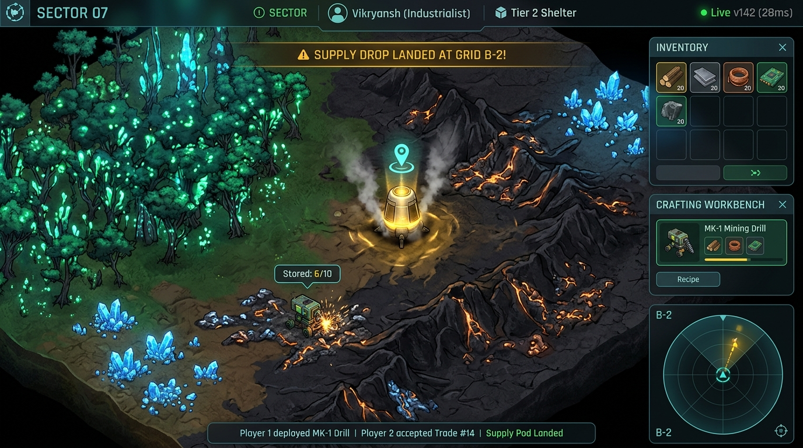

# Outpost — Shared-World Resource & Automation Game

A persistent, shared multiplayer resource management and automation game inspired by *Satisfactory*, engineered for high-concurrency relational data integrity.



---

## 🚀 Overview

**Outpost** addresses foundational distributed systems and database concurrency challenges in a shared multiplayer world:
* **Real-Time Contested Harvesting:** Zero-window single-statement atomic updates (`UPDATE resource_nodes SET remaining_units = remaining_units - 1 WHERE id = $1 AND remaining_units > 0`) eliminating race conditions across burst traffic.
* **Deadlock-Free P2P Trading:** Architecturally eliminates lock cycles via an escrowed standing-offer exchange (Appendix A.9.4 Fix 3).
* **Autonomous Machine Tick Engine:** Deployable MK-1 Automated Drills executing periodic background harvest ticks safely coordinated across multi-instance backends using PostgreSQL Advisory Locks.
* **Push-After-Commit Ordering:** WebSocket broadcasts trigger strictly in post-commit handlers with monotonic version sequences (`version`), ensuring client observers never see phantom or uncommitted state.
* **Tamper-Evident Ledger:** Append-only event history scaling past 5,000+ rows with composite B-tree indexing benchmarks (`EXPLAIN ANALYZE`).

---

## 🛠️ Technology Stack

| Layer | Technology | Primary Role |
| :--- | :--- | :--- |
| **Database** | **PostgreSQL 16** | ACID transactions, `CHECK (remaining_units >= 0)`, row locks, advisory locks, B-tree indexes |
| **Backend** | **Node.js (LTS) & Express** | REST API, parameterized transactions via `pg` connection pool, Machine Tick Engine |
| **Real-Time** | **Socket.io v4** | Push-After-Commit state distribution with monotonic sequence versioning |
| **Frontend** | **React (Vite) & Tailwind CSS** | Tactical dark-mode command dashboard, pannable sector map, radar minimap, crafting dock |
| **Testing** | **Node.js Harness & Jest** | 40-concurrent harvest race tests, 100-iteration trade rollback fault injection |

---

## 📁 Project Structure

```
Outpost/
├── docs/                     # Specifications, faculty feedback, and UI mockups
│   ├── PROJECT_PROPOSAL.md   # Complete approved proposal specification
│   ├── FRONTEND_SPEC.md      # UI components, layout, and WebSocket bindings
│   └── outpost_ui_concept.png# Concept artwork
├── server/                   # Backend Express & Machine Tick Engine
│   ├── src/
│   │   ├── db/               # PostgreSQL connection pool & schema migrations
│   │   ├── services/         # Harvest, Crafting, Trade, and Machine services
│   │   ├── socket/           # Real-time WebSocket emitter handlers
│   │   └── server.js         # API entry point
│   └── tests/                # Concurrency harness & fault-injection tests
├── client/                   # Frontend React (Vite) Application
│   ├── src/
│   │   ├── components/       # Map Viewport, Radar Minimap, Workbench, Ticker
│   │   └── App.jsx
│   └── tailwind.config.js
└── docker-compose.yml        # PostgreSQL & Redis infrastructure
```

---

## 🧪 Scaled Concurrency Test Suite

1. **40-Client Node Race:** 40 simultaneous requests fired at a node with 5 remaining units; asserts exactly 5 succeed (200 OK), 35 reject (409 Conflict), and remaining units land at exactly 0.
2. **100-Iteration Trade Rollback:** Injects mid-transaction exceptions to verify 100% clean rollback with zero orphaned escrowed items.
3. **Observer Monotonicity Test:** Asserts observer clients only receive committed, non-decreasing database versions.

---

## 👥 Authors
* **Hansika Malik**
* **Vikryansh Singh**
* *Full Stack Development — Semester Project*
