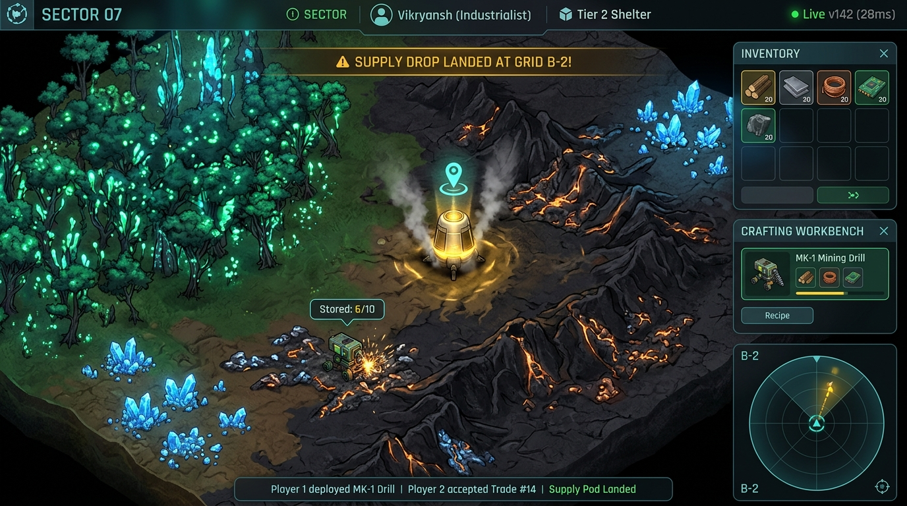

# Full Stack Development — Semester Project Proposal (Revised)

## Outpost: A Shared-World Automation & Resource Game

| Field | Detail |
| :--- | :--- |
| **Students** | Hansika Malik & Vikryansh Singh |
| **Project Domain** | Shared Multiplayer Automation & Concurrency (Satisfactory-Inspired Web Game) |
| **Specification Status** | Complete Architecture & UI Blueprint (With Concept Mockup & Scaled Tests) |

---

### 1. What Are We Building?

**Outpost** is a persistent, shared multiplayer resource management and automation game inspired by factory and logistics engineering (like *Satisfactory*), adapted into a high-concurrency tactical web dashboard. Players cooperate and compete to extract raw ores, process them into intermediate components, craft autonomous automated mining drills, and trade equipment through standing offers. All players and automated machines interact directly with the exact same authoritative PostgreSQL database state.

* **The Core Automation Loop:** Manual harvesting quickly shifts into industrial automation. Players craft deployable **"Automated Mining Drills"** that attach to contested nodes and autonomously harvest resources on periodic server-side ticks.
* **Machine Concurrency Integration:** The automated drills do not bypass concurrency rules. Each drill acts as an asynchronous background worker executing the exact same atomic harvest queries as human players. This creates a multi-agent race condition where human clicks, automated drills, and node replenishment routines all contend for the same finite database rows.
* **Deliberate Architectural Boundary:** Explicitly bounded to a tactical frontier command dashboard with a pannable map viewport and radar minimap. There is strictly no spatial tile navigation, continuous velocity syncing, or 3D player physics, keeping the entire engineering focus on database concurrency, transaction integrity, and deterministic state distribution.
* **Natural 5,000-Row Volume Generator:** Manual harvests, machine extraction events, intermediate smelting/crafting, and player trades are recorded in an append-only event ledger. This naturally generates over 5,000+ operational rows within minutes of live play for query indexing benchmarks.

---

### 2. User Interface & Tactical Viewport Architecture

Rather than synchronizing character walking over WebSockets (which introduces netcode jitter and packet desync), Outpost uses an explorable **Pannable Terrain Viewport** with **Radar Coordinate Tracking**.


*Figure 1: Concept UI Mockup — Pannable Terrain Viewport, Radar Minimap, Deployed MK-1 Drill, and Orbital Supply Pod Drop.*

* **Center Pannable Terrain Viewport:** A large $2500 \times 1800\text{ px}$ sector terrain. Players click-and-drag or scroll their viewport locally. Contested resource nodes appear at specific coordinates (Forests, Iron/Copper Mines, Crystal Geodes). Deployed MK-1 Drills display live mechanical mining animations and storage capacity bars (`Stored: 6/10`).
* **Tactical Radar Minimap (Bottom-Right):** A fixed radar widget showing a bird's-eye view of the sector. When an Orbital Supply Pod lands, a pulsing red coordinate ping flashes (e.g. `Grid B-2`). Clicking anywhere on the minimap instantly pans the player's viewport to the contested drop zone.
* **Sidebar Inventory & Crafting Workbench (Right):** Glassmorphic dock displaying real-time resource balances (Timber, Plates, Wires, Circuits) and interactive recipe cards with atomic crafting triggers.
* **Terminal Live Event Ticker (Bottom):** Streams live WebSocket commit events in real time (`[22:14:02] Vikryansh deployed MK-1 Drill`, `[22:14:15] Supply Pod Landed`, `[22:14:18] Race lost by 12ms`).

---

### 3. Technology Stack & Architectural Roles

* **Database (PostgreSQL 16):** Acts as the ultimate authority and last line of defence. Employs ACID transactions, relational CHECK constraints (`CHECK (remaining_units >= 0)`), row-level locks, PostgreSQL Advisory Locks (`pg_try_advisory_lock` for multi-instance safe background machine tickers), and composite B-tree indexes for fast audit ledger scans.
* **Backend Application & Machine Engine (Node.js LTS & Express):** Provides the REST API for player actions, authentication, and inventory queries. Utilizes the `pg` (node-postgres) driver pool to execute raw parameterized SQL transactions with deterministic transaction demarcation (`BEGIN` / `COMMIT` / `ROLLBACK`). Runs the autonomous Machine Tick Engine.
* **Real-Time Distribution (Socket.io v4):** Manages persistent WebSocket connections with active players. Operates strictly under a Push-After-Commit rule with monotonic sequence versioning.
* **Frontend Client (React via Vite & Tailwind CSS):** Tactical command dashboard featuring live node capacities, automated drill status cards, recipe workbenches, and escrow market boards.
* **Test Harness:** Automated Node.js Concurrency Harness (`Promise.all` & worker pools) + Jest / Supertest. Used to systematically fire burst traffic (e.g., 40 concurrent harvests against 5 units) and execute fault-injection rollback suites.

---

### 4. Hard Concurrency & Multi-Row Transaction Requirements

#### A. Contested Resource Node Harvesting (Appendix A.4 — Conditional Atomic Update)
With automated drills and multiple human players competing for the same finite node, a naive `SELECT`-then-`UPDATE` creates severe over-harvesting race conditions. Outpost implements a zero-window single-statement Conditional Atomic Update:

```sql
-- Atomic harvest decrement with zero locking window (Appendix A.4)
UPDATE resource_nodes
SET remaining_units = remaining_units - 1,
    version = version + 1,
    updated_at = NOW()
WHERE id = $1 AND remaining_units > 0
RETURNING remaining_units, version;
```

* **Zero-Window Semantics:** If the node has remaining units, the row updates atomically, increments `version`, and returns the new count. If `remaining_units == 0`, PostgreSQL affects 0 rows, instantly signalling that the node was exhausted.
* This query is executed identically whether triggered by a human player clicking the UI or an automated drill firing its background tick.

#### B. Autonomous Machine Tick Engine & Concurrency Safety (Appendix A.6 & A.8)
Deployable Automated Drills run on periodic server-side intervals (every 10 seconds). In a production deployment with multiple server instances, two instances must not process the same drill tick simultaneously:
* **Single-Run Instance Safety:** Each automated drill tick claims its processing turn using PostgreSQL Advisory Locks (`pg_try_advisory_xact_lock`) or `SELECT ... FOR UPDATE SKIP LOCKED` on active machine records.
* **Buffered Collection:** When a drill succeeds in harvesting, the extraction is committed to the machine's buffer and logged to the append-only event table in a single atomic transaction.

#### C. Player-to-Player Trading (Appendix A.9.4 — Standing-Offer Deadlock Avoidance)
Trading high-tier components (e.g., trading Circuit Boards for Energy Crystals) uses standing offers to eliminate deadlocks:
1. **Standing-Offer Creation:** Instead of a simultaneous dual-acceptance lock step, Player A creates a standing offer. Player A's offered items are atomically escrowed (removed from active inventory and held by the offer record in the database).
2. **One-Sided Acceptance:** When Player B clicks "Accept Offer", only Player B's transaction runs. That single transaction validates Player B's balance, transfers escrowed items to Player B, and deposits Player B's payment into Player A's account. Because only one transaction ever acquires locks during acceptance, a mutual wait cycle is structurally impossible (Appendix A.9.4 Fix 3).
3. **Deterministic Item Ordering:** Inside the acceptance transaction, multiple item rows are always locked in deterministic primary key order (Appendix A.9.2 Fix 1) to eliminate intra-transaction lock cycles.

---

### 5. Game Balance: Satisfactory-Inspired Tiered Recipe Tree

To satisfy the faculty requirement (*"Fix a small recipe set now"*) while delivering rich automation gameplay, the economy is strictly bounded to **4 base resources** and **6 craftable items/machines**:

#### Base Harvestable Resources
1. **Timber** (Forest Nodes — structural timber)
2. **Iron Ore** (Mine Veins — heavy metal components)
3. **Copper Ore** (Smelting Veins — electrical wiring)
4. **Energy Crystal** (Geode Nodes — machine power & high-tier beacons)

#### Fixed Recipe Tree & Machine Specifications

| Item / Machine | Type / Tier | Required Ingredients | Functionality & Concurrency Guard |
| :--- | :--- | :--- | :--- |
| **Iron Plate** | Component (T1) | 2x Iron Ore | Atomic inventory decrement; base building block. |
| **Copper Wire** | Component (T1) | 2x Copper Ore | Atomic inventory decrement; electrical conductor. |
| **Circuit Board** | Component (T2) | 2x Copper Wire + 1x Iron Plate | Multi-ingredient atomic consume; controls automated machine logic. |
| **Reinforced Frame** | Component (T2) | 2x Iron Plate + 2x Timber | Multi-ingredient atomic consume; machine structural chassis. |
| **Automated Miner (MK-1 Drill)** | **Machine (T3)** | 1x Reinforced Frame + 1x Circuit Board + 2x Iron Plate | Deployable machine; background worker extracts 1 unit / 10s via atomic update. |
| **Surveyor's Beacon** | **Objective (T3)** | 1x Reinforced Frame + 2x Circuit Board + 1x Energy Crystal | Final Outpost victory component; multi-row atomic creation. |

---

### 6. Real-Time Push-After-Commit & Ordering Contract

1. **Push-After-Commit Rule:** Socket.io broadcast calls (`io.emit('node_updated', payload)`) are executed strictly in the post-commit callback (after `await client.query('COMMIT')`). Emitting inside or before transaction commit is strictly forbidden, ensuring clients never observe a transient state that gets rolled back.
2. **Monotonic State Versioning:** Every resource node table contains a strictly monotonic integer column `version`. Every successful harvest increments this version (`version = version + 1`).
3. **Client Discard Rule:** Connected clients maintain `last_seen_version` for each node. If an asynchronous network packet arrives out of order (`packet.version <= last_seen_version`), the client immediately discards it, preventing the visual counter from jittering backwards.

---

### 7. Scaled Concurrency & Fault-Injection Verification Plan

#### Test 1: Scaled Node Race with Automated Drills (40 Concurrent Requests)
* **Setup:** Seed a resource node with exactly 5 remaining units.
* **Execution:** Using `Promise.all()`, dispatch 40 simultaneous harvest requests (combining human sessions + active automated drill ticks) at the exact same instant.
* **Assertion 1 (Success Count):** Exactly 5 requests receive HTTP 200 OK / successful extraction.
* **Assertion 2 (Exhaustion Rejection):** Exactly 35 requests receive HTTP 409 Conflict / 410 Gone ("Resource node already exhausted").
* **Assertion 3 (Zero Negative Stock):** A direct SQL query asserts `SELECT remaining_units FROM resource_nodes WHERE id = $1` equals exactly 0 (never negative, no over-allocation).
* **Assertion 4 (Log Accuracy):** Exactly 5 harvest log rows are present in the append-only audit table.

#### Test 2: Scaled Trade Rollback Fault-Injection (100 Iterations)
* **Execution:** An automated harness initiates a standing-offer trade acceptance in a loop of 100 consecutive runs.
* **Fault Injection:** A deliberate error/exception is injected halfway through the transaction (after removing escrowed components from Player A, but before crediting Player B).
* **Assertion:** 100 out of 100 iterations execute a clean `ROLLBACK` with zero orphaned items or uncommitted debits.

#### Test 3: Live State Linearizability & Monotonicity Test ("State Never Lies")
* **Execution:** An independent WebSocket observer client connects and records every state broadcast for a target node while automated drills and players contend for resources.
* **Assertion:** The sequence of node counts received by the observer is compared against PostgreSQL transaction commit logs. Assert that every count received was an actual committed state, counts strictly decrease (no bouncing backwards or skipping), and no phantom state ever reached the client.

---

### 8. Signature Features for Standout Engineering Portfolio

1. **Distributed Multi-Agent Automation (Appendix A.6 & A.8):** Deployable mining drills and node replenishment routines coordinated across multi-instance backends via PostgreSQL Advisory Locks (`pg_try_advisory_lock`), preventing duplicate ticks.
2. **Anti-Cheat Event Ledger Invariant:** Every player and machine buffer is continuously verified against the append-only event ledger:
   $$\text{Inventory} = \sum \text{Harvests} + \sum \text{Trades In} - \sum \text{Trades Out} - \sum \text{Craft Consumed} + \sum \text{Craft Produced}$$
3. **5,000-Row Query Optimization Benchmark:** Stress tests populate 5,000+ event rows. Database query response for player/machine history is profiled before and after composite B-tree indexing (`EXPLAIN ANALYZE`).
