# Outpost: Team Workflow & Step-by-Step Implementation Guide

**Project:** Outpost — Shared-World Automation & Resource Game  
**Course:** Full Stack Development (CSE Semester Project)  
**Team Members:** Vikryansh Singh & Hansika Malik  

---

## 1. Executive Summary & Role Allocation

To ensure maximum productivity, zero git merge conflicts, and strong individual viva contributions, the project is divided into two distinct, complementary tracks:

| Team Member | Primary Role | Git Feature Branch | Core Ownership |
| :--- | :--- | :--- | :--- |
| **Vikryansh Singh** | **Backend & Concurrency Lead** | `feature/backend-concurrency` | PostgreSQL schema, ACID transactions, atomic harvest, deadlock-free trades, advisory locks, background machine engine, and automated test harnesses. |
| **Hansika Malik** | **Frontend & Real-Time UX Lead** | `feature/frontend-dashboard` | React (Vite) + Tailwind CSS dashboard, $2500 \times 1800\text{ px}$ pannable map viewport, radar minimap, crafting workbench, trading post UI, and Socket.io client integration. |

```mermaid
flowchart TD
    subgraph Repo ["Git Repository: Outpost"]
        Main["main (Stable Production Branch)"]
        BranchVikryansh["feature/backend-concurrency (Vikryansh)"]
        BranchHansika["feature/frontend-dashboard (Hansika)"]
    end

    subgraph VikryanshWork ["Vikryansh: Backend & Concurrency Track"]
        DB["PostgreSQL 16 (Port 5433)"]
        API["Express REST API & pg Pool"]
        AtomicHarvest["Atomic Harvest (Appendix A.4)"]
        DeadlockTrades["Deadlock-Free Trades (Appendix A.9.4)"]
        MachineTicker["MK-1 Machine Ticker (Appendix A.6)"]
        TestHarness["40-Client Race & 100-Rollback Tests"]
    end

    subgraph HansikaWork ["Hansika: Frontend & Real-Time Track"]
        ReactApp["React + Vite + Tailwind CSS"]
        PannableMap["Pannable 2500x1800 Terrain Viewport"]
        RadarMinimap["Tactical Radar Minimap (Coordinate Pings)"]
        Workbench["Crafting Workbench & Inventory Dock"]
        TradeModal["Standing-Offer Trading Post UI"]
        SocketClient["Socket.io Client (Stale Packet Filter)"]
    end

    Main --> BranchVikryansh
    Main --> BranchHansika

    BranchVikryansh --> DB
    BranchVikryansh --> API
    BranchVikryansh --> AtomicHarvest
    BranchVikryansh --> DeadlockTrades
    BranchVikryansh --> MachineTicker
    BranchVikryansh --> TestHarness

    BranchHansika --> ReactApp
    BranchHansika --> PannableMap
    BranchHansika --> RadarMinimap
    BranchHansika --> Workbench
    BranchHansika --> TradeModal
    BranchHansika --> SocketClient

    TestHarness -.->|Verified PR| Main
    SocketClient -.->|Verified PR| Main
```



---

## 2. Shared Interface Contract (API & WebSockets)

Both team members can work simultaneously because the interface contract is fixed up front. Neither partner is blocked by the other.

### REST API Endpoints (`http://localhost:5000`)

| Endpoint | Method | Request Payload | Response Schema | Expected Status Codes |
| :--- | :---: | :--- | :--- | :--- |
| `/api/health` | `GET` | *None* | `{ status: "OK", timestamp }` | `200 OK` |
| `/api/nodes` | `GET` | *None* | `[ { id, name, resource_type, remaining_units, max_capacity, version, coord_x, coord_y, grid_sector, status } ]` | `200 OK` |
| `/api/nodes/:id/harvest` | `POST` | `{ playerId: 1 }` | `{ success: true, data: { node, harvestedItem, playerInventoryTotal } }` | `200 OK`<br>`409 Conflict` (Exhausted) |
| `/api/players/:id/inventory`| `GET` | *None* | `[ { item_type, quantity } ]` | `200 OK` |
| `/api/recipes` | `GET` | *None* | `{ iron_plate: { ingredients, outputQuantity }, ... }` | `200 OK` |
| `/api/craft` | `POST` | `{ playerId: 1, item: "circuit_board" }` | `{ success: true, data: { craftedItem, quantity, totalInInventory } }` | `200 OK`<br>`422 Unprocessable` (Deficient) |
| `/api/trades` | `GET` | *None* | `[ { id, creator_name, offered_item, offered_quantity, demanded_item, demanded_quantity, status } ]` | `200 OK` |
| `/api/trades` | `POST` | `{ creatorPlayerId: 1, offeredItem, offeredQuantity, demandedItem, demandedQuantity }` | `{ success: true, data: trade }` | `201 Created`<br>`422 Unprocessable` |
| `/api/trades/:id/accept` | `POST` | `{ buyerPlayerId: 2, simulateFault: false }` | `{ success: true, data: { tradeId, status: "COMPLETED" } }` | `200 OK`<br>`409 Conflict`<br>`422 Unprocessable` |
| `/api/events` | `GET` | *None* | `[ { id, player_id, event_type, details, version, created_at } ]` | `200 OK` |

### WebSocket Events (`Socket.io`)

| Event Name | Direction | Payload | Client Action |
| :--- | :---: | :--- | :--- |
| `NODE_STATE_UPDATED` | Server $\rightarrow$ Client | `{ nodeId, remainingUnits, version, updatedAt }` | If `version > localNodeVersion`: update capacity bar. Else **discard stale update**. |
| `NEW_TRADE_OFFER` | Server $\rightarrow$ Client | `{ id, creator_name, offered_item, offered_quantity, demanded_item, demanded_quantity }` | Append new offer card to Trading Post market tab. |
| `TRADE_COMPLETED` | Server $\rightarrow$ Client | `{ tradeId, buyerId, sellerId }` | Remove offer from active market list; refresh buyer/seller inventories. |
| `SUPPLY_DROP_LANDED` | Server $\rightarrow$ Client | `{ dropId, gridCoord: "B-2", contents: "2x Circuit Boards" }` | Flash top alert banner & trigger pulsating red ping on Radar Minimap. |

---

## 3. Step-by-Step Implementation Guide for Vikryansh
**Track:** Backend, Database & Concurrency Architecture  
**Directory:** `Outpost/server/`  
**Git Branch:** `feature/backend-concurrency`

### Step 1: Branch Setup & Environment
1. Switch to a new branch:
   ```bash
   cd Outpost
   git checkout -b feature/backend-concurrency
   ```
2. Verify Docker and PostgreSQL 16 are running on port `5433`:
   ```bash
   docker compose up -d
   ```

### Step 2: Database Schema & Relational Constraints
1. Work in `server/src/db/schema.sql`.
2. Ensure hard constraints are active:
   * `CONSTRAINT chk_remaining_units_non_negative CHECK (remaining_units >= 0)` on `resource_nodes`.
   * `CONSTRAINT chk_quantity_non_negative CHECK (quantity >= 0)` on `inventories`.
   * Range exclusion constraint `EXCLUDE USING gist` for time-leased node claims.
   * Composite B-tree index `idx_event_logs_player_created` on `(player_id, created_at DESC)`.
3. Run initialization: `npm run db:init`.

### Step 3: Implement Zero-Window Atomic Harvest
1. File: `server/src/services/harvestService.js`.
2. Use single-statement conditional update:
   ```sql
   UPDATE resource_nodes
   SET remaining_units = remaining_units - 1, version = version + 1, updated_at = NOW()
   WHERE id = $1 AND remaining_units > 0
   RETURNING id, remaining_units, version;
   ```
3. If `rowCount === 0`, return `HTTP 409 Conflict: RESOURCE_EXHAUSTED`.
4. Trigger Socket.io broadcast strictly **after** `COMMIT`.

### Step 4: Implement Deadlock-Free Trading Post
1. File: `server/src/services/tradeService.js`.
2. `createStandingOffer`: Deduct offered item from creator and escrow it into `standing_trades (status='OPEN')`.
3. `acceptStandingOffer`: Execute single-transaction acceptance. Deduct buyer payment $\rightarrow$ credit buyer with escrow $\rightarrow$ credit seller $\rightarrow$ mark `COMPLETED`.
4. Add `simulateFault: boolean` parameter to support mid-transaction crash testing.

### Step 5: Implement Multi-Ingredient Atomic Crafting
1. File: `server/src/services/craftService.js`.
2. Implement sorted ingredient locking (Appendix A.9.2) to prevent internal deadlock.
3. Validate quantities, decrement ingredients, and deposit crafted output (*Iron Plates, Copper Wire, Circuit Boards, MK-1 Drills*). Rollback cleanly if deficient.

### Step 6: Implement Background Machine Engine (MK-1 Drills)
1. File: `server/src/services/machineTicker.js`.
2. Set up a 10-second interval timer.
3. Wrap each machine tick in a PostgreSQL Session Advisory Lock:
   ```sql
   SELECT pg_try_advisory_lock(9001);
   ```
4. If lock acquired, execute atomic harvest against attached node and buffer extracted units.

### Step 7: Run and Capture Concurrency Test Proofs
1. Run Test 1 (40 requests vs 5 units): `npm run test:concurrency`
2. Run Test 2 (100 trade rollback iterations): `npm run test:rollback`
3. Run Test 3 (5,000-row index scaling benchmark): `npm run test:scale`
4. Confirm results are written to `docs/evidence/test_run_evidence.txt`.

### Step 8: Commit & Pull Request
```bash
git add .
git commit -m "feat(server): complete backend concurrency engine, machine ticker, and scaled test suites"
git push -u origin feature/backend-concurrency
```

### 🎓 Vikryansh's Viva Talking Points
* *"I designed the harvest mechanism as a single-statement conditional atomic update (`UPDATE ... WHERE remaining > 0`), which eliminates row locks and application-level mutexes while making negative capacity mathematically impossible."*
* *"To prevent the 40P01 deadlock that occurs in two-party exchanges, I engineered a standing-offer flow where only the accepting party acquires locks."*
* *"I proved system resilience under load by firing 40 simultaneous requests at a 5-unit node, asserting exactly 5 succeeded and remaining units stayed at 0."*

---

## 4. Step-by-Step Implementation Guide for Hansika
**Track:** Frontend, Real-Time Client & Tactical Dashboard  
**Directory:** `Outpost/client/`  
**Git Branch:** `feature/frontend-dashboard`

### Step 1: Branch Setup & Vite Initialization
1. Switch to a new branch:
   ```bash
   cd Outpost
   git checkout -b feature/frontend-dashboard
   ```
2. Initialize React + Vite project in `client/`:
   ```bash
   npm create vite@latest client -- --template react
   cd client
   npm install
   npm install -D tailwindcss postcss autoprefixer
   npx tailwindcss init -p
   npm install socket.io-client lucide-react clsx
   ```

### Step 2: Configure Dark-Mode Sci-Fi Styling
1. In `tailwind.config.js`, configure slate and neon accent colors:
   ```javascript
   theme: {
     extend: {
       colors: {
         frontier: {
           950: '#030712',
           900: '#0f172a',
           800: '#1e293b',
           cyan: '#06b6d4',
           emerald: '#10b981',
           amber: '#f59e0b'
         }
       }
     }
   }
   ```
2. Set up base layout structure: Top Bar, Center Viewport, Right Sidebar, Bottom Ticker matching [outpost_ui_concept.png](file:///home/vikryansh/Workspace/projects/fsd/Outpost/docs/outpost_ui_concept.png).

### Step 3: Implement the $2500 \times 1800\text{ px}$ Pannable Map Viewport
1. File: `client/src/components/MapViewport.jsx`.
2. Create a large inner canvas container (`2500px` width $\times$ `1800px` height) inside an outer container with `overflow: hidden`.
3. Implement click-and-drag panning:
   * Track `panPosition = { x, y }` in React state.
   * On mouse down $\rightarrow$ track mouse move deltas $\rightarrow$ update `panPosition`.
   * Apply CSS `transform: translate(${panPosition.x}px, ${panPosition.y}px)`.
   * **Why this is genius:** Panning is 100% client-side; zero server lag!

### Step 4: Build Interactive Resource Node Cards
1. File: `client/src/components/NodeCard.jsx`.
2. Map over nodes from `GET /api/nodes` and render them at absolute coordinates `(coord_x, coord_y)` on the terrain canvas.
3. Card displays:
   * Biome icon (🌲 Timber, 🪨 Iron, ⛏️ Copper, 💎 Crystal).
   * Visual capacity meter: `[██████░░░░] 6/10 Units`.
   * Authoritative version badge (`v24`).
   * **[HARVEST]** button calling `POST /api/nodes/:id/harvest`.
4. Visual feedback:
   * On 200 OK: Emerald ripple animation + `+1 Resource` floating text.
   * On 409 Conflict: Red border shake + `Exhausted by another player` toast.

### Step 5: Build Tactical Radar Minimap with Coordinate Pings
1. File: `client/src/components/RadarMinimap.jsx`.
2. Place a $200 \times 150\text{ px}$ mini-map fixed in the bottom-right corner.
3. Draw a moving white rectangle showing where the user's camera is currently looking.
4. When `SUPPLY_DROP_LANDED` fires at `B-2`:
   * Render a pulsating red radar circle at `B-2` (`animate-ping`).
   * Allow clicking that quadrant to immediately center the main viewport over `B-2`!

### Step 6: Build Sidebar Inventory Dock & Crafting Workbench
1. File: `client/src/components/Sidebar.jsx` & `CraftingWorkbench.jsx`.
2. **Inventory Dock:** Query `GET /api/players/1/inventory` and display slots for Timber, Iron Plates, Copper Wire, Circuit Boards, and Crystals.
3. **Crafting Workbench:** Display recipe cards:
   * Show required ingredients with green checkmarks or red counts (`Timber: 2/2 ✅ | Iron: 0/1 ❌`).
   * Enable **[CRAFT ITEM]** button only when requirements are met.
   * On click, call `POST /api/craft`.

### Step 7: Build Standing-Offer Trading Post Modal
1. File: `client/src/components/TradingPost.jsx`.
2. **Tab 1 (Market Offers):** List open standing trades from `GET /api/trades`. Each card has a single-click **[ACCEPT OFFER]** button calling `POST /api/trades/:id/accept`.
3. **Tab 2 (Create Offer):** Form allowing the player to choose what item to put in escrow and what item to demand, calling `POST /api/trades`.

### Step 8: Socket.io Client & Stale Packet Discard Filter
1. File: `client/src/services/socket.js`.
2. Connect to backend: `const socket = io('http://localhost:5000')`.
3. Listen for `NODE_STATE_UPDATED`:
   ```javascript
   socket.on('NODE_STATE_UPDATED', (payload) => {
     setNodes((prevNodes) =>
       prevNodes.map((node) => {
         if (node.id === payload.nodeId) {
           // Drop stale out-of-order packets
           if (payload.version <= node.version) return node;
           return { ...node, remaining_units: payload.remainingUnits, version: payload.version };
         }
         return node;
       })
     );
   });
   ```

### Step 9: Build Bottom Live Event Ticker Feed
1. File: `client/src/components/EventTicker.jsx`.
2. Listen to Socket event `GLOBAL_TICKER_LOG` and append lines to a retro-modern scrolling terminal drawer.

### Step 10: Commit & Pull Request
```bash
git add .
git commit -m "feat(client): complete tactical command dashboard, pannable viewport, and socket client"
git push -u origin feature/frontend-dashboard
```

### 🎓 Hansika's Viva Talking Points
* *"I architected the frontend client in React and Tailwind, designing a $2500 \times 1800\text{ px}$ pannable terrain map that gives players full exploration freedom without incurring real-time server spatial netcode overhead."*
* *"I implemented client-side monotonic version filtering (`version <= last_seen_version`), ensuring that asynchronous WebSocket packets arriving out of order are discarded and never cause the visual counter to flicker backwards."*
* *"I built the interactive Radar Minimap that receives real-time orbital supply drop coordinate pings, letting players navigate and click to contest drops in under two seconds."*

---

## 5. Integration, Multi-Window Demo & Merge Process

Once both branches are pushed to GitHub:

```bash
# 1. Update main branch
git checkout main
git pull origin main

# 2. Merge Backend Branch
git merge feature/backend-concurrency -m "merge: integrate backend concurrency engine"

# 3. Merge Frontend Branch
git merge feature/frontend-dashboard -m "merge: integrate frontend tactical dashboard"

# 4. Push updated main to GitHub
git push origin main
```

### The Live Evaluation Demo (Two Windows Side-by-Side)
1. Start PostgreSQL: `docker compose up -d`
2. Start Backend: `cd server && npm start`
3. Start Frontend: `cd client && npm run dev`
4. Open two browser windows:
   * **Window 1:** Logged in as **Vikryansh** (Left side of screen)
   * **Window 2:** Logged in as **Hansika** (Right side of screen)
5. **Show Sir the Concurrency Race:**
   * Both navigate to *Iron Ridge Vein #1* (1 unit remaining).
   * Click **[HARVEST]** on both windows simultaneously.
   * Window 1 gets the Iron Ore with an emerald ripple; Window 2 instantly receives a red toast: *"Already harvested (HTTP 409)"*.
   * Sir sees Window 2's capacity bar drop to 0 via Socket.io with zero page refresh!
6. **Show Sir the Deadlock-Free Trade:**
   * Vikryansh posts a standing offer: 2 Iron Plates for 1 Energy Crystal.
   * Hansika's market tab updates automatically over WebSockets.
   * Hansika clicks **[ACCEPT OFFER]** $\rightarrow$ single-transaction atomic swap commits with zero deadlock risk!
